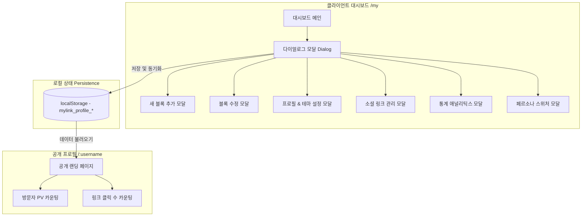

# 🤖 마이링크 (MyLink) Gemini 에이전트 종합 개발 지침서

@AGENTS.md

---

## 1. 프로젝트 핵심 개발 지침 (Guidelines)

### 1.1 프레임워크 및 라우팅 (Next.js 16 & React 19)
- **Next.js 16 (App Router)** 컨벤션을 엄격히 준수합니다.
- 동적 라우터의 `params`는 비동기 Promise 객체이므로 `const { username } = await params;` 형태로 안전하게 로드합니다.
- 클라이언트 컴포넌트는 최상단에 `'use client';` 선언을 포함합니다.

### 1.2 디자인 시스템 및 UI 컴포넌트 (Tailwind CSS v4 & shadcn/ui)
- CSS Modules 대신 **Tailwind CSS v4** 및 **shadcn/ui** 컴포넌트를 사용합니다.
- 토스 디자인 시스템(TDS) 스타일의 모바일 퍼스트 인터페이스 및 직관적인 UI UX 가이드라인을 유지합니다.

### 1.3 대시보드 폼 및 모달 시스템
- 사용자 입력을 받는 모든 추가/수정/설정 폼은 반드시 **다이얼로그 모달(Dialog)** 로 구현합니다.
- 서버 백엔드 미연동 시연 단계에서는 `localStorage` 기반 로컬 상태 관리(`src/lib/profileStorage.ts`)를 활용하여 즉시 미리보기가 가능하도록 합니다.

### 1.4 언어 및 표기 규칙
- 모든 지침 문서, 주석, UI 사용자 안내 텍스트는 **한국어**로 작성합니다.

---

## 2. 개발 계획서 (Plan Document)

> 상세 문서: `@docs/PLAN.md`

### 2.1 개발 목표
- 마이링크(MyLink) 대시보드의 다이얼로그 모달 기반 블록/프로필/소셜/통계 CRUD 관리 구현.
- 백엔드 서버 미연동 시연 단계에서 `localStorage` 기반 퍼시스턴트 로컬 상태 동기화 및 실시간 미리보기 서빙.

### 2.2 서비스 구조도 (Architecture)

---

## 3. 태스크 현황표 (Task Checklist)

> 상세 문서: `@docs/TASKS.md`

### 3.1 구현 완료 태스크
- [x] **타입 및 데이터 스토리지**
  - `src/types/index.ts`: `clicks`, `pageViews` 속성 확장
  - `src/lib/profileStorage.ts`: `recordPageView`, `recordLinkClick` 추적 함수 구현
- [x] **대시보드 다이얼로그 폼 (Dialog Modal Forms)**
  - `src/app/my/page.tsx`:
    - [x] **새 링크/헤더 블록 추가 다이얼로그** (제목, URL, 아이콘, 공개 여부)
    - [x] **블록 정보 수정(Edit) 다이얼로그** (기존 데이터 pre-fill 및 편집)
    - [x] **프로필 정보 & 테마 프리셋 다이얼로그** (닉네임, 한줄소개, 아바타URL, 테마 6종, 버튼 스타일 3종)
    - [x] **소셜 아카이브 링크 관리 다이얼로그** (인스타그램, 유튜브, 깃허브 등 추가/삭제)
    - [x] **대시보드 통계 & 애널리틱스 다이얼로그** (총 PV, 총 클릭수, 개별 링크 클릭 비율 퍼센트 바)
    - [x] **페르소나 / 프로필 스위처 다이얼로그** (`demo`, `creator_hana`, `dev_minjun`, `design_yuna` 및 신규 핸들 생성)
    - [x] **블록 순서 변경 (Up/Down)** (목록 위치 이동 및 저장)
- [x] **구글 소셜 로그인 & Firestore 개인화 (Google Auth & Firestore Personalization)**
  - `src/lib/firebase.ts`: `loginWithGoogle`, `logoutFirebase`, `saveUserProfileToFirestore` 구현
  - `src/context/AuthContext.tsx`: 전역 인증 상태 및 유저 프로필 관리
  - `src/components/Header.tsx`: 구글 로그인/로그아웃, 유저 프로필 및 `users/{user.uid}/links` 경로 복사 버튼
  - `src/app/my/page.tsx`:
    - `users/{user.uid}/links` 경로 기반 개인화된 실시간 링크 CRUD
    - 대시보드 상단 Firestore 유저 정보(사진, 닉네임, 이메일, UID, 경로) 시각화
    - 미로그인 시 로그인 유도 및 기능 설명 화면 제공
- [x] **와이어프레임 1:1 오프닝 랜딩 페이지 (`src/app/page.tsx`)**
  - `Development in One Link.` 타이포그래피, 상단 헤더, `Google로 시작하기` CTA 버튼
  - 3D 틸트 목업 카드 및 로그인 후 `/my` 본 페이지 자동 전환 연동
- [x] **공개 프로필 연동**
  - `src/components/ProfileView.tsx`: 마운트 시 PV 자동 누적 및 링크 클릭 시 클릭수 집계

---

## 4. 기능 워크스루 가이드 (Walkthrough Document)

> 상세 문서: `@docs/WALKTHROUGH.md`

### 4.1 대시보드 시연 가이드 (`/my`)

1. **블록 추가**: `/my` 대시보드 상단 `[+ 블록 추가]` 버튼 클릭 ➔ 웹사이트 링크 또는 섹션 헤더 다이얼로그 작성 후 추가.
2. **블록 수정**: 목록 항목의 연필(✏️) 아이콘 클릭 ➔ 정보 수정 다이얼로그에서 내용 변경 후 저장.
3. **프로필 & 테마 설정**: `[프로필·테마]` 버튼 클릭 ➔ 닉네임/Bio/아바타 변경 및 Light/Dark/Neon/Pastel/Minimal/Gradient 6종 테마 및 버튼 스타일 적용.
4. **소셜 링크 관리**: `[소셜 링크]` 버튼 클릭 ➔ 소셜 매체 URL 추가 및 삭제.
5. **통계 분석**: `[통계]` 버튼 클릭 ➔ 총 PV, 누적 클릭수 및 개별 링크 클릭 퍼센트 바 시각적 데이터 확인.
6. **프로필 전환**: `[프로필 전환]` 버튼 클릭 ➔ 더미 페르소나 선택 또는 새 URL 핸들로 즉시 로컬 프로필 스위칭.
7. **공개 프로필 미리보기**: `[공개 보기]` 버튼 클릭 ➔ `/[username]` 공개 프로필 페이지에서 실시간 반영 결과 확인.
