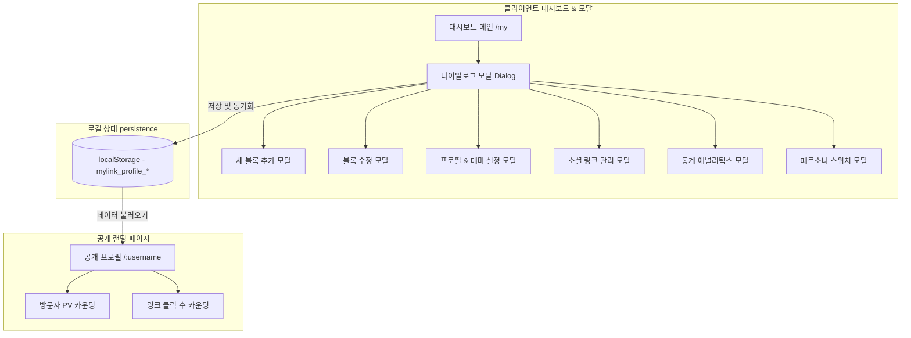

# 📋 [PLAN] 마이링크 (MyLink) 개발 계획서

## 1. 개요 및 목표
본 계획서는 **마이링크(MyLink)** 링크인바이오 서비스의 대시보드 기능 확장, 다이얼로그 모달 기반 CRUD 구현, 테마 및 통계 시스템 구축을 위한 개발 로드맵을 정의합니다.

---

## 2. 아키텍처 및 기술 스택

### 2.1 주요 기술 스택
- **Framework**: Next.js 16 (App Router)
- **UI Library**: React 19, Tailwind CSS v4, shadcn/ui (`@base-ui/react/dialog`)
- **Icons**: Lucide Icons (`lucide-react`)
- **State Management**: `localStorage` 기반 퍼시스턴트 로컬 상태 (`src/lib/profileStorage.ts`)

---

## 3. 단계별 개발 추진 로드맵 (Phased Roadmap)

### Phase 1: 로컬 스토리지 데이터 아키텍처 구축 (완료)
- `ProfileData`, `LinkItem`, `SocialLinkItem` 타입 확장 (클릭수 `clicks`, 방문수 `pageViews` 추가)
- `getProfileData`, `saveProfileData`, `recordPageView`, `recordLinkClick` 유틸리티 구현

### Phase 2: 다이얼로그 모달 기반 대시보드 구축 (완료)
- `/my` 대시보드 화면 설계
- 블록 추가/수정/삭제/순서변경 기능 다이얼로그 구현
- 테마 6종(`light`, `dark`, `neon`, `pastel`, `minimal`, `gradient`) 및 버튼 스타일 3종 선택 폼 모달 탑재
- 소셜 아카이브 링크 CRUD 모달 탑재
- 프로필/페르소나 스위처 모달 구현

### Phase 3: 통계 및 실시간 미리보기 연동 (완료)
- 통계 분석 모달(총 PV, 클릭수, 개별 링크 클릭율 퍼센트 바) 구현
- 공개 프로필 페이지(`/[username]`) 연동 및 클릭 추적 검증

---

## 4. 품질 및 보안 기준
1. **반응형 디자인**: 320px 모바일 뷰포트부터 데스크톱 뷰포트까지 유연한 반응형 레이아웃 적용.
2. **Next.js 16 컨벤션**: 서버 컴포넌트의 비동기 `params` 처리 strict 검증.
3. **URL 유효성 방어**: HTTP/HTTPS 및 mailto 스키마 자동 포맷팅.
