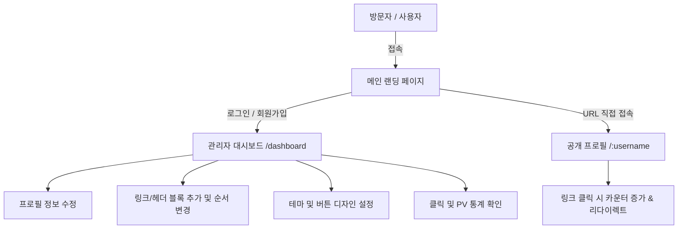

# 📄 [PRD] 마이링크 (MyLink) 제품 요구사항 정의서

## 1. 프로젝트 개요 (Overview)

### 1.1 프로젝트 목적 및 배경
- **마이링크(MyLink)**는 개인 크리에이터, 프리랜서, 사용자가 자신의 소셜 미디어, 블로그, 포트폴리오 등의 개별 링크를 하나로 집약하여 공유할 수 있는 **링크인바이오(Link-in-bio) 서비스**입니다.
- 인스타그램, TikTok, X(구 트위터) 등 단일 링크만 허용하는 SNS 프로필에서 활용도를 극대화할 수 있도록 모바일 최적화 및 빠른 응답 속도를 목표로 합니다.

### 1.2 주요 타겟 사용자
- **개인 크리에이터 및 인플루언서**: 다중 채널(유튜브, 블로그, 인스타그램 등)을 운영하는 사용자
- **프리랜서 및 퍼스널 브랜딩 유저**: 포트폴리오, 오픈채팅, 마켓 링크 등을 통합 안내하려는 사용자

### 1.3 핵심 사용자 시나리오 (User Scenarios)

#### 🎬 시나리오 A: 신규 크리에이터 온보딩 및 첫 프로필 생성
1. 크리에이터 '민지'는 인스타그램 프로필 바이오에 넣을 단일 통합 링크가 필요해 **마이링크** 서비스에 접속한다.
2. Google 소셜 로그인을 통해 5초 만에 가입하고, 자신만의 고유 URL 핸들(`mylink.com/minji`)을 선점한다.
3. 아바타 프로필 이미지, 닉네임, 한줄 소개를 입력하고 주요 활동 링크(유튜브, 스마트스토어, 블로그) 3개를 추가한다.
4. 파스텔 테마와 라운드 버튼 스타일을 적용하여 우측 라이브 프리뷰로 최종 디자인을 확인한 뒤 URL을 복사해 인스타그램 바이오에 게재한다.

#### 🔄 시나리오 B: 대시보드에서 링크 추가 및 Drag & Drop 순서 변경
1. 크리에이터 '민지'는 오늘 새로 업로드된 유튜브 신규 영상 링크를 최상단에 강조 노출하고 싶다.
2. 마이링크 대시보드에 접속해 '링크 추가' 버튼을 누르고 영상 제목과 URL을 등록한다.
3. 드래그 앤 드롭(Drag & Drop) 핸들을 잡아 새로 추가된 링크 블록을 목록 최상단으로 끌어올린다.
4. 우측 실시간 모바일 프리뷰 화면에 즉시 순서 변경이 반영된 것을 확인하고 수정을 마친다.

#### 📱 시나리오 C: 방문자의 프로필 페이지 접속 및 링크 클릭
1. SNS 팔로워 '지훈'은 민지의 인스타그램 프로필에서 `mylink.com/minji` 링크를 터치한다.
2. 모바일 웹 환경에 최적화된 반응형 프로필 랜딩 페이지가 1.2초 이내로 빠르게 로딩된다.
3. 지훈이가 '🎬 신규 유튜브 영상 바로가기' 버튼을 클릭하면, 시스템에서 해당 링크의 클릭 수가 +1 카운팅된 뒤 유튜브 앱/웹으로 즉시 이동한다.

#### 📊 시나리오 D: 대시보드 통계(애널리틱스) 확인 및 성과 분석
1. 크리에이터 '민지'는 주말을 맞아 자신의 링크인바이오 유입 성과를 분석하기 위해 대시보드의 '통계' 탭에 접근한다.
2. 지난 7일/30일간의 총 프로필 방문자 수(PV)와 각 링크별 클릭 수, 일별 클릭 추이 라인 차트를 시각적으로 확인한다.
3. 어떤 링크가 팔로워들에게 가장 반응이 좋은지 파악하고 다음 콘텐츠 마케팅 전략에 반영한다.

---

## 2. 핵심 기능 요구사항 (Functional Requirements)



### 2.1 사용자 인증 및 계정 관리 (Auth & Account)
| 기능 ID | 기능명 | 상세 설명 | 우선순위 |
| :--- | :--- | :--- | :--- |
| **AUTH-01** | 이메일/비밀번호 회원가입 및 로그인 | Auth.js (NextAuth) 기반의 이메일 인증 기능 | P0 |
| **AUTH-02** | 소셜 로그인 | Google 소셜 로그인 간편 인증 지원 | P0 |
| **AUTH-03** | 커스텀 핸들(URL) 설정 | 회원가입 시 중복되지 않는 고유 `username` 설정 (`mylink.com/[username]`) | P0 |
| **AUTH-04** | 비밀번호 재설정 | 이메일 기반 비밀번호 찾기/재설정 링크 발송 | P2 |

### 2.2 관리자 대시보드 (Dashboard & Editor)
| 기능 ID | 기능명 | 상세 설명 | 우선순위 |
| :--- | :--- | :--- | :--- |
| **DASH-01** | 실시간 미리보기 모바일 목업 | 수정 사항이 실시간 반영되는 우측 모바일 라이브 프리뷰 창 | P0 |
| **DASH-02** | 프로필 관리 | 아바타 이미지 업로드/수정, 닉네임, 한줄 소개(Bio) 입력 | P0 |
| **DASH-03** | 링크 블록 CRUD | 웹사이트 제목, URL, 썸네일/아이콘 지정, 활성화(On/Off) 토글 | P0 |
| **DASH-04** | 헤더/구분선 블록 | 링크 그룹 구분을 위한 섹션 헤더(Section Header) 블록 추가 | P1 |
| **DASH-05** | Drag & Drop 순서 변경 | `@hello-pangea/dnd` 또는 `@dnd-kit` 기반의 링크 및 헤더 위치 이동 | P0 |

### 2.3 공개 프로필 페이지 (`/[username]`)
| 기능 ID | 기능명 | 상세 설명 | 우선순위 |
| :--- | :--- | :--- | :--- |
| **PAGE-01** | 반응형 모바일 퍼스트 레이아웃 | 모바일 환경에 특화된 깔끔하고 빠른 로딩의 단일 페이지 랜딩 | P0 |
| **PAGE-02** | 링크 클릭 추적 & 리다이렉트 | 링크 클릭 시 서버에서 이벤트 기록 후 목표 URL로 빠른 이동 | P0 |
| **PAGE-03** | 소셜 아카이브 아이콘 | 프로필 하단에 인스타그램, 유튜브, GitHub 등 소셜 아이콘 바 제공 | P1 |

### 2.4 디자인 및 테마 시스템 (Design & Themes)
| 기능 ID | 기능명 | 상세 설명 | 우선순위 |
| :--- | :--- | :--- | :--- |
| **THEME-01** | 프리셋 테마 6종 | Light, Dark, Neon, Pastel, Minimal, Gradient 테마 제공 | P0 |
| **THEME-02** | 버튼 스타일 선택 | 라운드(Rounded-full), 모서리(Rounded-md), 아웃라인(Outline) 등 스타일 옵션 | P1 |
| **THEME-03** | 배경 커스텀 | 단색 컬러, 파스텔 그라디언트 선택 기능 | P1 |
| **THEME-04** | shadcn/ui 디자인 시스템 | CSS Modules 없이 Tailwind CSS 및 shadcn/ui 기반으로 UI 컴포넌트를 설계하고 재사용성을 확보 | P0 |

### 2.5 통계 및 애널리틱스 (Analytics)
| 기능 ID | 기능명 | 상세 설명 | 우선순위 |
| :--- | :--- | :--- | :--- |
| **STAT-01** | 총 프로필 방문자 수 (PV) | 프로필 페이지의 누적 조회수 기록 및 표시 | P1 |
| **STAT-02** | 링크별 개별 클릭 수 | 등록된 각 링크별 누적 클릭 이벤트 횟수 집계 | P0 |
| **STAT-03** | 일별 클릭 추이 차트 | 최근 7일 / 30일간의 개별 및 전체 링크 클릭 추이 라인 차트 | P1 |

---

## 3. 데이터 아키텍처 및 스키마 정의 (Data Architecture)

### 3.1 기술 스택 (Tech Stack)
- **Framework**: Next.js 16 (App Router)
- **Language**: TypeScript
- **Styling & UI Components**: Tailwind CSS v4, Lucide Icons, **shadcn/ui** (Tailwind CSS v4 기반 컴포넌트 디자인 시스템 사용. CSS Modules는 사용하지 않으며 Tailwind CSS와 shadcn/ui 재사용 컴포넌트로 스타일링을 일관되게 관리)
- **Database & ORM**: PostgreSQL, Prisma ORM (또는 Supabase)
- **Authentication**: Auth.js v5 (NextAuth)
- **State & UI Libs**: Zustand (클라이언트 대시보드 ↔ 라이브 프리뷰 동기화 전역 상태), React 19, `@dnd-kit/core` (Drag & Drop), Recharts (차트 시각화)

### 3.2 데이터베이스 ERD (Database Schema)

```prisma
model User {
  id            String    @id @default(cuid())
  email         String    @unique
  passwordHash  String?
  username      String    @unique // URL 핸들: mylink.com/[username]
  name          String?
  bio           String?
  image         String?
  theme         String    @default("light") // light, dark, neon, pastel, minimal, gradient
  buttonStyle   String    @default("rounded") // rounded, corner, outline
  createdAt     DateTime  @default(now())
  updatedAt     DateTime  @updatedAt

  blocks        Block[]
  socialLinks   SocialLink[]
  pageViews     PageView[]
}

enum BlockType {
  LINK
  HEADER
}

model Block {
  id          String    @id @default(cuid())
  userId      String
  user        User      @relation(fields: [userId], references: [id], onDelete: Cascade)
  type        BlockType @default(LINK)
  title       String
  url         String?   // LINK 타입일 때 사용
  icon        String?
  isActive    Boolean   @default(true)
  order       Int
  createdAt   DateTime  @default(now())
  updatedAt   DateTime  @updatedAt

  clicks      ClickLog[]
}

model SocialLink {
  id        String   @id @default(cuid())
  userId    String
  user      User     @relation(fields: [userId], references: [id], onDelete: Cascade)
  platform  String   // instagram, youtube, github, twitter, email 등
  url       String
  order     Int
}

model PageView {
  id        String   @id @default(cuid())
  userId    String
  user      User     @relation(fields: [userId], references: [id], onDelete: Cascade)
  createdAt DateTime @default(now())
}

model ClickLog {
  id        String   @id @default(cuid())
  blockId   String
  block     Block    @relation(fields: [blockId], references: [id], onDelete: Cascade)
  createdAt DateTime @default(now())
}
```

### 3.3 더미 데이터 명세 (Dummy / Seed Data)

> [!NOTE]
> **시연 단계(Step 1)** 에서는 백엔드 DB 대신 아래 더미 데이터를 `localStorage`에 시딩하여 프로필 페이지 UI를 검증합니다.
> 파일 위치: [`src/lib/dummyData.ts`](../src/lib/dummyData.ts)

#### 샘플 프로필 목록

| # | 변수명 | username | 페르소나 | 테마 | 버튼 스타일 | 링크 수 | 소셜 수 |
|---|---|---|---|---|---|---|---|
| 1 | `CREATOR_PROFILE` | `creator_hana` | 🎨 크리에이터 (하나) | pastel | rounded | 9 (비활성 1 포함) | 4 |
| 2 | `DEVELOPER_PROFILE` | `dev_minjun` | 💻 개발자 (김민준) | dark | corner | 11 | 4 |
| 3 | `DESIGNER_PROFILE` | `design_yuna` | 🎨 디자이너 (박유나) | neon | outline | 11 | 4 |

#### 커버리지 검증 항목
더미 데이터는 다음 UI 요소를 모두 커버하도록 설계되었습니다:

- **헤더 블록** (`isHeader: true`): 각 프로필에 2~3개의 섹션 구분 헤더 포함
- **비활성 링크** (`isActive: false`): 크리에이터 프로필에 1개 포함 — 토글 Off 시 비표시 로직 검증
- **아이콘 종류**: `Globe`, `Youtube`, `BookOpen`, `Mail`, `Github`, `Instagram`, `Twitter` 전체 커버
- **테마 3종 분산**: pastel / dark / neon (나머지 테마는 기존 `INITIAL_PROFILE_DATA`의 gradient + 에디터에서 전환 테스트)
- **버튼 스타일 3종 분산**: rounded / corner / outline

#### 사용 방법
```typescript
import { CREATOR_PROFILE, getDummyProfile, DUMMY_PROFILES } from '@/lib/dummyData';

// 특정 프로필 조회
const profile = getDummyProfile('dev_minjun');

// 전체 더미 프로필 순회
DUMMY_PROFILES.forEach(p => console.log(p.username, p.name));
```

---

## 4. 비기능 요구사항 (Non-Functional Requirements)

1. **성능 (Performance)**
   - 공개 프로필 페이지(`/[username]`)의 LCP(Largest Contentful Paint)는 **1.2초 이내**로 서빙되어야 합니다.
   - Next.js Server Components 및 Edge Caching / ISR을 활용하여 데이터 로딩을 극대화합니다.
2. **반응형 디자인 (Responsiveness)**
   - 320px 모바일 뷰포트부터 1440px+ 데스크톱 화면까지 완벽 지원합니다.
3. **보안 (Security)**
   - XSS 방지를 위한 URL 유효성 검사 (HTTP/HTTPS 스키마 허용)
   - 비밀번호는 bcrypt / argon2 안전 암호화 저장
   - 사용자 인증 상태 검증 middleware 처리
4. **SEO 및 Open Graph**
   - 프로필 페이지별 메타 태그(`og:title`, `og:description`, `og:image`) 자동 생성

---

## 5. 릴리즈 및 개발 단계 (Phased Roadmap)

> [!NOTE]
> **시연용 단계별 진행 전략 (Demonstration Phased Approach)**
> 시연을 위해 대시보드 및 백엔드 DB/통계 기능 구축 전, **Step 1으로 로컬 스토리지 기반의 프로필 페이지를 먼저 제작**합니다.

- **Step 1: 로컬 스토리지 기반 공개 프로필 페이지 (현재 시연 단계)**
  - 대시보드/통계 보류, `localStorage` 기반 프로필 데이터 및 링크 목록 서빙
  - 동적 프로필 라우팅 (`/[username]`) 및 프리셋 테마 적용
  - **더미 데이터 활용**: `src/lib/dummyData.ts`에 정의된 3가지 페르소나(크리에이터·개발자·디자이너) 샘플 프로필을 사용하여 링크 목록, 테마, 소셜 아이콘 등 핵심 UI를 시연 (상세 명세는 §3.3 참조)
- **Step 2: 관리자 대시보드 & 실시간 모바일 프리뷰 (Editor)**
  - 대시보드 UI, 링크 CRUD, Drag & Drop 순서 변경 (Zustand 전역 상태 연동)
- **Step 3: 백엔드 DB & 회원 인증 (Infra & Auth)**
  - Prisma / Supabase (PostgreSQL) 데이터베이스 연동 및 Auth.js (NextAuth) 회원가입/로그인
- **Step 4: 통계 & 최종 최적화 (Analytics & Polish)**
  - 링크 클릭 수 및 방문자 수 차트(Recharts) 연결, SEO 및 모바일 반응형 최적화
